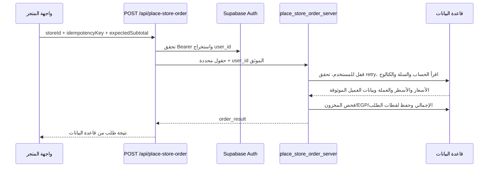
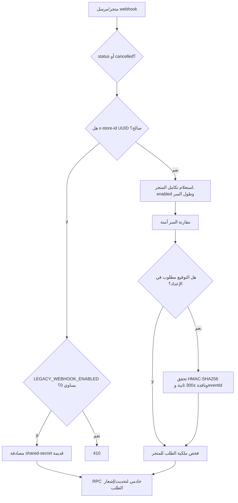
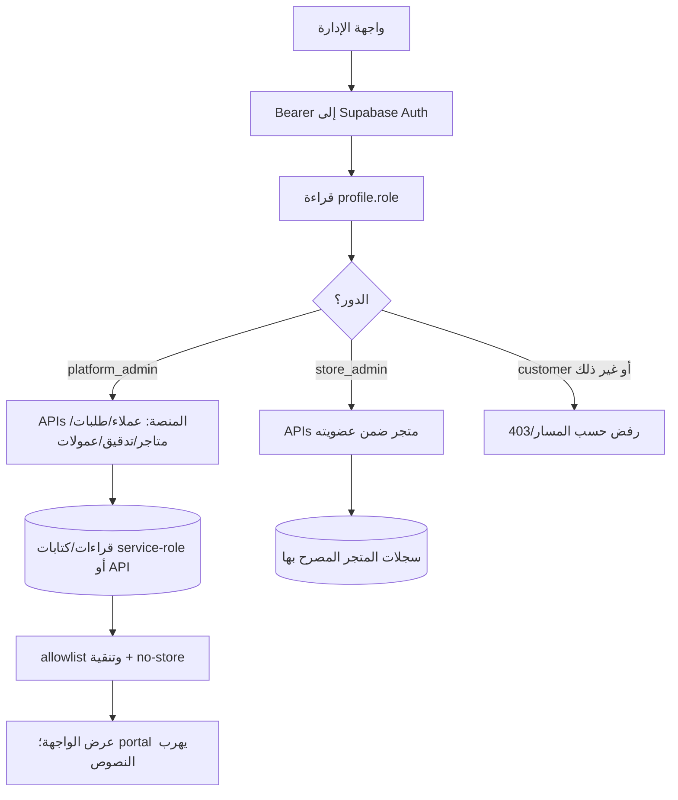

# مراجعة أمنية لمسارات API وواجهات المتجر الحساسة

**التاريخ:** 2026-11-11
**النطاق:** مراجعة قراءة فقط لتدفقات المتجر والحساب والضيف والطلبات والويبهوكات والشحن ولوحات الإدارة والعمولات وحدود Worker/Railway.
**مرجع الشيفرة:** `181468d31c81af5db06f874ea1e5e75fbf22bc87` (`main` مطابق لـ`origin/main` وفق نتائج المراجعة).
**تنبيه صريح:** إعدادات البيئة/قاعدة الإنتاج لم تُفحص. كما لم تُراجع لوحات Cloudflare أو Railway، ولم يثبت أن النشر الحي يطابق هذا الرأس أو أن migrations وRPC وإعدادات المعدلات والبريد مفعّلة كما في المصدر. لم تُشغّل اختبارات ضمن هذا التقرير؛ أرقام الاختبارات المذكورة هي فقط ما أوردته نتائج التحليل.

> هذا المستند تجميع وتحليل لما ورد في نتائج مراجعة المستودع فقط، وليس اختبار اختراق أو شهادة عن حالة تشغيلية حية. لا يفيد أن أي توصية أدناه نُفذت؛ جميعها مقترحات عمل مستقبلية.

## 1. خلاصة تنفيذية

يُظهر المصدر والاختبارات المقروءة فصلًا مقصودًا بين بيانات العميل المرتبطة بحساب موثّق وبين سجل الضيف وإشاراته، كما أن واجهة الطلب لا ترسل حقول العنوان أو المستلم أو أسطر المنتجات إلى API إنشاء الطلب. تعتمد عدة مسارات حساسة على التحقق الخادمي من Bearer token، واستخراج `user_id` من هوية موثقة، وRLS أو RPC بصلاحية `service_role`، وقوائم حقول صريحة في الاستجابات. توجد كذلك ضوابط في التكرار، ومعدلات الطلب، والتنقية، و`Cache-Control: no-store` بحسب المسار.

في المقابل، أظهرت المراجعة ثغرات اتساق/تفويض تستحق ترتيب الأولوية: رمز استعادة سلة الإلغاء يُستهلك بفحص ثم كتابة غير ذرية ويعيد بيانات اتصال حتى في حالات غير `pending`؛ تحديث الشحن لا يقارن الحالة عند الكتابة؛ مسار الدفع القديم للعمولة يتجاوز سير إثبات التسوية؛ ومحددات المعدل قد تكون محلية لا مشتركة حسب البيئة. كما توجد مخاطرة فقد تحديثات السلة المتزامنة، واحتمال تعطل إعادة محاولة البريد بعد توقف العملية، وتسجيل نشاط قابل لإعادة الإرسال، واختلافات في التصفح والتحقق من المدخلات بين واجهات الإدارة.

هذه نتائج مراجعة مصدرية؛ لا ينبغي تفسيرها كإثبات أن المسارات أو الإعدادات منشورة أو أن سيناريو بعينه وقع فعليًا.

## 2. قواعد قراءة الجداول ومصطلحات الثقة

- **المصادقة** تعني إثبات هوية مقدم الطلب؛ **التفويض** يعني التحقق من أنه يملك الدور/المتجر/السجل المطلوب. وجود رمز Bearer لا يكفي وحده لإثبات الملكية.
- **مصدر الحقيقة** هو المصدر الذي يعيد بناء القرار أو البيانات الموثوقة (مثل `customer_details` أو `cart_items` أو الكتالوج في قاعدة البيانات)، لا الحقول التي يعرضها المتصفح.
- **`service_role`** امتياز خادمي حساس؛ المسارات المعروضة تستدعيه من الخادم/RPC. لا ينبغي وضع مفتاحه في المتصفح.
- **اعتماد حامل (bearer capability)** هو سرّ يمنح من يحمله القدرة على تنفيذ إجراء دون جلسة حساب؛ رمز استعادة الطلب مثال على ذلك.
- **CAS** تعني كتابة شرطية تقارن الحالة/الإصدار الحالي بالقيمة التي قرأها المسار، لتفادي أن يكتب طلب قديم فوق تغيير أحدث.
- عندما يقال «حسب الشيفرة» فالمقصود ما تصفه الملفات والاختبارات المراجعة، لا إعداد إنتاج أو استجابة خدمة حية.

## 3. مخطط التدفق العام للمتجر والحساب والطلب

```mermaid
flowchart TD
  B[المتصفح] -->|تحميل الصفحة| H[index.html ثم auth-session / consent / guest-identity / app]
  H --> CAT[قراءة كتالوج عام من Supabase REST]
  H --> G{ضيف أم جلسة حساب؟}
  G -->|ضيف، والإشارات مفعلة| GC[/api/guest-cart وإشارات الضيف]
  G -->|حساب موثق| AC[customer_details وcart_items وfavorites بهوية المستخدم]
  AC --> ORDER[مراجعة الطلب: إرسال storeId + idempotencyKey + expectedSubtotal فقط]
  ORDER --> AUTH[تحقق Bearer واستخراج المستخدم في API]
  AUTH --> RPC[RPC خادمي بصلاحية service_role]
  RPC --> DB[(البيانات الموثوقة: الحساب + السلة + الكتالوج)]
  DB --> RESULT[نتيجة الطلب؛ السلة لا تُحذف عند الإنشاء]
  AC --> ORDERS[GET /api/customer-orders: سجلات المستخدم وحقول منقّاة]
```

### 3.1 فتح المتجر والجلسة

يحمل `index.html` ملفات `auth-session.js` ثم `consent.js` و`guest-identity.js`، ثم `app.js` الذي يحمل `app-core.js`. يبدأ المتجر بقراءة الكتالوج العام. إذا كانت إشارات الضيف مفعلة تُحمّل سلة الضيف، وإلا/أو مع وجود جلسة مستخدم تُحمّل بيانات الحساب ذات الصلة. `auth-session.js` يجدد access token قبل انتهائه، ينسق التجديد بين التبويبات، يعيد محاولة 401 مرة واحدة، ولا يغيّر الطلبات العامة/غير المصرح بها. `signOut` يمحو الجلسة محليًا ويرسل الإبطال إلى Supabase.

### 3.2 حسابي والبيانات الشخصية

فتح «حسابي» يتطلب جلسة. يقرأ المتصفح صف `customer_details` المرتبط بـ`uid` باستخدام المفتاح العام وBearer المستخدم. عند أول زيارة، يتيح نموذج إكمال البيانات إذا كانت ناقصة، وإلا يعرض نموذج مراجعة للقراءة فقط. تفاصيل الاسم والهاتف والعناوين والمستلم تبقى في الذاكرة `ACCT` وتُحفظ في قاعدة البيانات، لا في `localStorage`؛ البريد المعروض مأخوذ من `AUTH.user.email` ولا يُخزن في `customer_details`.

تشمل بيانات العميل الاسم والهاتف والمحافظة والمدينة والشارع/المنطقة ورقم المبنى والدور والشقة والإحداثيات، وعنوان شحن مماثل أو مستقل، ومستلمًا اختياريًا وملاحظات توصيل. قيود قاعدة البيانات تطبّع القيم وتحدد طولها/صيغتها، وtrigger يمنع تبديل مالك الصف أو `created_at` ويزامن عنوان الشحن عند `ship_same`. تقصر سياسات RLS قراءة/كتابة الصف على `auth.uid()` ولا تتيح حذفًا عبر العميل.

### 3.3 إنشاء الطلب



واجهة المتجر لا ترسل بيانات العميل/المستلم/العنوان ولا أسطر المنتجات. يعيد الخادم/قاعدة البيانات بناء المشتري والمستلم والعنوان والبريد (من `auth.users`) والطلب من `customer_details` وسلة الحساب والكتالوج. يركّب العنوان من أجزائه، ويضيف بيانات المشتري إلى الملاحظات إذا اختلف المستلم، وقد يضيف رابط إحداثيات اختياريًا. `expectedSubtotal` حارس مقارنة فقط وليس مصدر السعر. قاعدة البيانات تعيد بناء الأسعار والأسطر والعملة ورقم التتبع، وتعيد رفض السعر/المخزون/العملة غير المقبولة.

يحتاج الطلب إلى حساب دائم؛ الضيف يُحوّل إلى التسجيل ثم يعود إلى المتجر. يستخدم التنفيذ قفلًا استشاريًا لكل مستخدم، ومفتاح محاولة ضمن المستخدم، وحدًا موصوفًا قدره 20 طلبًا للمستخدم/ساعة. يمكن أن يعيد محاولة مطابقة الطلب المفتوح نفسه. تبقى السلة بعد إنشاء الطلب حتى نتيجة دفع موثوقة في المرحلة الثانية؛ لا يوجد في نتائج التحليل ما يبرر تغيير هذا السلوك أو آلية الدفع.

### 3.4 مزامنة السلة والحساب

السلة المحلية `elan_cart` كاش مرتبط بـ`elan_cart_owner`. اختلاف المالك يمحو الكاش القديم. تُقرأ سلة الحساب من `cart_items` بتوكن المستخدم؛ أول مزامنة قد تدمج كاشًا غير مملوك بكمية الأكبر، لا بجمع الكميات، ثم تحفظ عبر `/api/customer-cart`. الخروج يمسح كاش السلة والمفضلة محليًا، ولا يمسح صفوف الحساب. تمنع الواجهة الدفع من سلة فارغة إذا لم يحمّل الكتالوج.

كتابة سلة العميل وكتابة سلة الضيف استبدالان كاملان. يجعل SQL استبدال سلة الحساب ذريًا ضد الفشل الجزئي، لكنه لا يظهر revision/CAS في API؛ لذلك قد تطغى لقطة قديمة من تبويب على أحدث عند التزامن. هذا قصور اتساق محتمل، وليس دليلًا على استغلال وقع.

## 4. تدفقات الضيف والخصوصية والنشاط

### 4.1 رسم تدفق هوية الضيف

```mermaid
flowchart TD
  Browser[متصفح ضيف: UUID محلي/كوكي وإشارات] -->|resolve/save/track/identify/forget| API[/api/guest-cart]
  Browser -->|أحداث session/search/product| ACT[/api/customer-activity]
  API --> HMAC[الخادم يحول معرف المتصفح إلى HMAC]
  ACT --> HMAC2[الضيف: HMAC؛ الحساب: user_id من Bearer]
  HMAC --> GDB[(سجلات الضيف guest_visitors والسلة/الإشارات)]
  HMAC2 --> ADB[(سجلات النشاط والبحث واللقطات)]
  Browser -->|تسجيل/تأكيد| Carry[/api/signup-carry claim بتوكن الحساب]
  Carry -->|claim قبل مزامنة السلة| Account[حساب المستخدم]
  Carry -->|بعد النقل| Cleanup[حذف/إنهاء أثر الضيف وفق المسار]
```

هوية الضيف ليست بيانات الحساب. توجد UUID محلية وcookie script، إضافة إلى `elan_gid` من الخادم، ومعرّفات جلسة/منتج/بحث وإشارات جهاز خشنة. يرسل متصفح الضيف إشارات افتراضيًا إلى سجل الضيف. يطبق الخادم HMAC قبل التخزين، فلا يُخزن مفتاح المتصفح الخام بوصفه هوية مطابقة. عند login/confirmation يجري claim قبل مزامنة السلة؛ أما تقدير التشابه عبر إشارات الجهاز/الشبكة والسلوك فهو للعد فقط، لا لنقل السلة أو الأحداث. النقل يعتمد المفتاح الدقيق أو تسجيل الدخول؛ الاختبارات والنتائج تقول إن مطابقة الشبكة المزدحمة أو بين شخصين مسجلين مختلفين تُرفض.

رفض الزائر أو GPC يوقف/يمحو إشارات الضيف وبياناته فقط؛ لا يمنع التصفح أو السلة، ولا يمس بيانات العميل المسجل أو نشاطه المرتبط بحسابه. السياسة تقرر خيار الرفض فقط دون شريط موافقة، وهذه سياسة مالك لا يقترح هذا التقرير تغييرها. توجد ملاحظة توثيقية: تعليق `guest-identity.js` يذكر جملة في نموذج التسجيل عن موافقة نشاط العميل، بينما قرار `CLAUDE.md` والاختبار يقولان إن الجملة حُذفت في 3 نوفمبر. بحسب المراجعة هو اختلاف تعليق داخلي فقط، لا يظهر في الواجهة ولا يغير السلوك.

### 4.2 التسجيل ونقل السلة (`signup-carry`)

في التسجيل، قد يحتفظ المتصفح المنشئ بالسلة/المفضلة بمعرّف UUID للحساب غير المؤكد. متصفح تأكيد البريد أو تسجيل الدخول يطالب بالقوائم قبل claim/مزامنة السلة. `stash` عام بلا توكن، بينما `claim` يتطلب Bearer الحساب ويتجاهل `userId` من body ويستخرج الهوية من التوكن. تقفل قاعدة البيانات صف carry (`FOR UPDATE`) وتستهلكه مرة واحدة بعد النقل؛ الكميات تتلاقى بالأكبر لا الجمع. فشل واجهة النقل لا يمنع الدخول. دوال الشراء/الحساب الأساسية ممنوعة عن `anon` و`authenticated` وممنوحة `service_role` فقط وفق الاختبارات/الترحيلات المقروءة، والـwrappers تستقبل هوية تحققت منها API.

### 4.3 النشاط والبريد

`POST /api/customer-activity` يقبل أحداث session/search/product محددة الأنواع والأحجام. للضيف يتحقق من مفاتيح UUID ويحوّل المعرف إلى HMAC؛ وللمستخدم الموثق يتحقق الخادم من Bearer ويربط الحدث بـ`user_id` بدل بصمة ضيف. يخزن البحث النص الدقيق (حتى 200 محرف بحسب النتائج) ولقطات نتائج حتى 10؛ إزالة التكرار المذكورة للبحث داخل الطلب الواحد لا تمنع إعادة POST كاملًا. الحد المذكور 600 طلب/دقيقة/IP في الشيفرة، وليس حدًا لكل هوية/جلسة.

`POST /api/customer-mail` لا يقبل عنوان مستلم من body؛ يستمد البريد من المستخدم الموثق، ولا يرسل إلا لحساب دوره `customer` وبريده مؤكد. أحداث التسجيل/الدخول محددة؛ يُحجز slot ذري في سجل البريد قبل SMTP، وعند فشل SMTP المرئي يحرره. يصف التحليل خطر توقف العامل بعد الحجز وقبل الإرسال: يمكن أن يبقى الحجز 100 سنة عمليًا، ما يجعل التصميم أقرب إلى at-most-once منه إلى طابور موثوق. قيم إعدادات SMTP غير مفحوصة.

## 5. جداول مسارات API الحساسة للمتجر والحساب

الجدول التالي يلخص العقود كما وردت في النتائج؛ «المصدر» لا يعني أن قاعدة الإنتاج تحققت.

| Method / path | المصادقة والتفويض | المدخلات الموثوقة/المسموحة | مصدر الحقيقة | المخرجات/ملاحظات |
|---|---|---|---|---|
| GET `/api/config` | عام بحسب الاستخدام المذكور؛ إعداد اتصال عام | لا توجد بيانات مستخدم مذكورة | إعدادات اتصال عامة في التطبيق/الخادم | يطلب إعداد الاتصال العام؛ وجود URL/مفتاح في المصدر لا يثبت الإعداد الحي أو توفره. |
| Supabase Auth مباشرة: تسجيل/دخول/استعادة/تأكيد/تجديد/خروج | تدفق Auth؛ Bearer للطلبات المحمية | بيانات المصادقة/الجلسة | Supabase Auth | جلسة ورموز محفوظة محليًا في `elan_auth_session`؛ التجديد/إبطال الخروج موصوفان في العميل. |
| قراءة كتالوج Supabase REST | قراءة عامة بمفتاح عام | استعلامات المنتجات/العروض | كتالوج المتجر | منتجات/عروض، لا سجل العميل. |
| GET/POST `/rest/v1/customer_details` | مفتاح عام + Bearer المستخدم؛ RLS على `auth.uid()` | حقول ملف العميل ذات القيود؛ لا حذف عميل | صف `customer_details` | قراءة/كتابة صف الحساب؛ البريد ليس من هذا الجدول. |
| GET `/rest/v1/cart_items` و`/rest/v1/favorites` | Bearer المستخدم وRLS | معرّفات/كميات السلة أو المفضلة | صفوف الحساب | قراءة تخص الحساب؛ كتابة سلة الحساب تتم عبر API/RPC خادمي بحسب التدفق. |
| POST `/api/guest-cart` | أفعال الضيف عامة بمفتاح UUID/كوكي؛ `claim` يتطلب Bearer صالحًا ودور customer في RPC | `resolve/save/track/identify/claim/forget`؛ سلة حتى 100 سطر وكمية 1–99 | HMAC ومخازن/سجلات الضيف وRPC | `forget` يمحو بيانات الضيف وينهي كوكي الخادم عند نجاح الحذف؛ `claim` ينقل سلة/أحداثًا وفق آلية القاعدة. no-store وحدود حسب الفعل. |
| POST `/api/customer-activity` | ضيف بمفاتيح UUID؛ أو Bearer مستخدم يتحقق منه الخادم | session/track/search وأنواع/أحجام محددة؛ search حتى 200 محرف و10 نتائج | سجل الجلسات والأحداث والبحث؛ HMAC للضيف أو `user_id` للمستخدم | نتيجة `tracked` من RPC؛ 600/دقيقة/IP في المصدر؛ لا idempotency لطلب الحدث الكامل ظاهر. |
| POST `/api/signup-carry` (`stash`) | بلا Bearer؛ لا تكشف نتيجة وجود الحساب | `userId` UUID، قوائم سلة/مفضلة منظفة (حدود 100/200 في النتائج) | RPC/صف carry؛ DB تتحقق من حساب customer غير المؤكد وعمر أقل من 24 ساعة والمنتجات | `{ok:true}` حتى إن رفضت الدالة العنصر لتجنب probe؛ حد 10/دقيقة/IP. |
| POST `/api/signup-carry` (`claim`) | Bearer؛ هوية المستخدم من التوكن لا من body | فعل claim؛ القاعدة تنقل القوائم مرة واحدة | صف carry وقاعدة الحساب | أعداد فقط؛ حد 30/دقيقة/IP؛ قفل/استهلاك ذري وفق SQL المراجع. |
| POST `/api/customer-cart` | `authenticateCustomer`؛ customer/store_admin/platform_admin | `items`، حتى 100 سطر؛ تحقق DB من البنود/الكمية | `cart_items` وRPC استبدال خادمي | `{ok:true,items:[...]}`؛ الاستبدال معاملاتي ضد الفشل الجزئي، لكن لا revision/CAS أو محدد معدل ظاهر. |
| POST `/api/place-store-order` | Bearer يتحقق منه `authenticateCustomer`؛ أدوار customer/store_admin/platform_admin | `storeId` UUID، `idempotencyKey` بطول 8–64، `expectedSubtotal` رقمي موجب فقط | الحساب + `customer_details` + السلة + الكتالوج؛ RPC `place_store_order_server` | `order_result` من القاعدة؛ السعر والأسطر والعملة والبيانات لا تؤخذ من العميل. no-store/محددات تكرار حسب التحليل. |
| GET `/api/customer-orders` | Bearer؛ الأدوار customer/store_admin/platform_admin؛ استعلام الملكية من `user_id` الموثق | `limit` 1–100، `offset` 0–100000، `year` 4 أرقام، `q` حتى 100 محرف | `checkout_sessions` باستخدام service-role ومرشح المستخدم | صفحات/طلبات/أسطر/شحنات بقائمة حقول منقاة؛ يستبعد الهاتف والعنوان و`customer_*` وسبب الإلغاء؛ no-store. |
| POST `/api/request-store-order-cancellation` | Bearer الحساب | `requestId` وسبب اختياري | طلب إلغاء يصل إلى المتجر | طلب إلغاء لا يلغي بذاته، كما يصف التحليل. |
| POST `/api/restore-store-order` | لا جلسة حساب؛ `restoreToken`/`token` هو اعتماد حامل | رمز UUID؛ محدد 30/دقيقة/IP في المصدر | سجل `store_order_cart_restorations` | قد يعيد رقم التتبع/الطلب/العناصر/الهاتف/البريد. فحص العمر 30 يومًا؛ مشكلة التزامن والحالات موضحة أدناه. |
| POST `/api/customer-mail` | Bearer؛ حساب customer وبريد مؤكد | حدث registered/login؛ المستلم مشتق لا من body | المستخدم الموثق وسجل `customer_mail_log` وإعداد SMTP | `mail_not_configured` أو `already_sent` أو 202؛ إخطار منصة بحسب إعداد بيئي غير مفحوص. |

### 5.1 استعادة سلة طلب ملغى: مسار ذو أولوية

الرمز `restore_token` يُنشأ عند الإلغاء ويُرسل في URL؛ الواجهة تستدعي API دون Bearer وتضيف العناصر محليًا بكمية الأكبر ثم تمسح query بعد النجاح أو انتهاء الصلاحية. لذلك فالرمز اعتماد حامل، وليس مجرد معرف. وفق المراجعة، يقرأ المسار السجل ثم يعمل PATCH على `id` دون شرط بقاء الحالة `pending` ودون فحص عدد الصفوف المتأثرة. يمكن لطلبين متزامنين قراءة `pending` ثم كلاهما الحصول على رد ناجح وحمولة PII. كذلك تعيد الواجهة الخلفية الهاتف والبريد والعناصر لكل سجل غير منتهٍ حتى لو كانت الحالة `restored`؛ وأي حالة غير `pending` (ومنها `expired` حديثة ضمن العمر) قد تحصل على رد ثابت يقول `restored`. فحص العمر وحده لا يعالج الحالة.

هذه نتيجة قراءة المصدر والاختبارات، لا دليل على وجود رمز مكشوف أو استغلال فعلي. كما أن اختبار التكرار الحالي الموصوف يغطي `restored` مسبقًا ولا يغطي سباقًا متزامنًا؛ واختبار `expired` القديم لا يغطي `expired` حديثًا.

## 6. تدفقات الويبهوك واللوحة والشحن

### 6.1 رسم توجيه الويبهوك



عند `x-store-id` صالح، يطبّع إلى lowercase ويقرأ `store_integrations` للمتجر، ويتحقق من السر الخاص بالمتجر وحالة التفعيل وطول لا يقل عن 16. عند UUID غائب/غير صالح يمكن أن يدخل المسار القديم ذي shared-secret؛ `LEGACY_WEBHOOK_ENABLED=0` يرد 410 لهذا الفرع بحسب الشيفرة، ولا نعرف قيمته في الإنتاج. المقارنة تستخدم `safeEqual`/`timingSafeEqual`؛ سر غير مضبوط يعطي 503، وسر مفقود/خاطئ 401. إخفاقات مصادقة المتجر موحدة كي لا تكشف وجود متجر أو سر.

في مسار per-store يُفحص أن رقم التتبع يعود إلى `store_id` المصادق عليه؛ سجل غير موجود أو تابع لمتجر آخر يعطي 404، وفشل القراءة 502. نتائج التحليل تنبه إلى أن مسار shared-secret في status/cancelled لا يجري فحص ملكية المتجر نفسه قبل RPC في handler؛ لم تُراجع دلالات RPC كاملة، لذلك لا يُستنتج أثر ذلك على قاعدة البيانات. أما التوقيع فيُفحص بعد مصادقة المتجر فقط، عندما يكون `STORE_WEBHOOK_SIGNATURE_REQUIRED === '1'`.

التوقيع الحالي يحسب على `timestamp + '.' + eventId + '.' + JSON.stringify(body)`، مع قبول ±300 ثانية، و`eventId` حتى 200 محرف. هذا توقيع على إعادة التسلسل لا بايتات HTTP الخام؛ اختلاف ترتيب المفاتيح/المسافات قد ينتج توقيعًا مختلفًا. في status/cancelled ينسخ `eventId` الموقّع إلى الجسم؛ مفاتيح idempotency الصريحة تتقدم عليه. مع مصادقة per-store تُحوّل المفاتيح إلى `storeId:SHA256(raw)` لمنع تصادم متجرين مع الحفاظ على إعادة المحاولة للمتجر نفسه. في shared-secret يبقى المفتاح كما أرسله المرسل.

### 6.2 جدول واجهات المتجر والويبهوك

| Method / path | المصادقة والتفويض | المدخلات | مصدر الحقيقة | المخرجات/ضوابط |
|---|---|---|---|---|
| POST `/api/store-order-status` | سر per-store عند UUID صالح، واختياريًا توقيع حسب الإعداد؛ أو shared-secret legacy عند UUID غير صالح/غائب إن لم يُعطّل | إشعار الحالة، `trackingNumber`، مفاتيح idempotency/حدث حسب العقد | الطلب والمتجر في قاعدة البيانات وRPC server-side | تحديث/إشعار؛ 401 موحد، 503 عند غياب السر، 429 عند حد 120/60ث/IP، 502 لأخطاء upstream غير الحمولة. aliases في الجدول التالي. |
| POST `/api/store-order-completed` و`/api/store-order-status-check` | يعاد توجيههما إلى status وفق `vercel.json` | نفس عقد status | نفس المصدر | مساران قديمان للتوافق؛ لا دليل على استهلاكهما الحي. |
| POST `/api/store-order-cancelled` | سر per-store أو shared-secret legacy؛ توقيع اختياري حسب الإعداد | `trackingNumber` أو `orderNumber`؛ في مسار المتجر يمكن مطابقة `checkout_tracking_number`؛ سبب/عناصر وفق payload | الطلب وبيانات المتجر وRPC | إشعار/طلب إلغاء منفصل؛ shared-secret لا يفحص ملكية الطلب في handler بحسب المراجعة. لا يتعامل مع OPTIONS وفق الملف المقروء. |
| POST/OPTIONS `/api/store-catalog-figures` | webhook per-store؛ لا shared-secret/legacy | بيانات figures؛ يتجاهل `store_id` من body ويستخدم `p_store_id` المصادق؛ حتى 1000 سجل | تكامل المتجر وRPC/الكتالوج | لا مفتاح idempotency عام من endpoint؛ التعليقات تقول التكرار غير ضار والأقدم لا يستبدل الأحدث، لكن DB غير مراجعة كاملة. |
| GET `/api/store-dashboard-orders` | Bearer وجلسة؛ store_admin ضمن عضويته أو platform_admin | مرشحات/صفحات حسب API | عضويات المتجر والطلبات | بيانات توصيل ضمن allowlist، no-store؛ المنصة تستطيع تحديد متجر أو تحصل على قائمة فارغة دون تحديده. |
| PATCH/POST `/api/store-order-update` | `store_admin` ضمن المتجر أو `platform_admin`؛ جلسة Supabase | حالة الطلب/سبب الرفض/حقول مسموحة | الطلب الحالي وجدول الانتقالات | تحديث شرطي CAS على `id` والحالة المقروءة؛ الفائز وحده يصدر notification. فشل الإشعار لا يتراجع عن التحديث. |
| PATCH/POST `/api/store-shipment-update` | `store_admin` ضمن المتجر أو `platform_admin`؛ جلسة Supabase | حالة/بيانات الشحن المسموحة | الطلب والشحنة الحالية وجدول الانتقالات | فحص ثم upsert غير شرطي بالحالة المقروءة؛ سباق ممكن أن يسمح بكتابة انتقال أقدم بعد أحدث. فشل الإشعار لا يتراجع عن الحفظ. |
| GET/PUT `/api/store-integrations` | `platform_admin` فقط | إعدادات التكامل؛ PUT يحل اسم المتجر إلى UUID | `store_integrations` ثم fallback legacy إلى `site_settings` عند غياب الصف | GET يخفي الأسرار بقناع؛ خانات API key/webhook secret الفارغة تحفظ السر الحالي؛ no-store. |

### 6.3 التوقيع وCORS وقيود التوافق

فحص التوقيع ليس شاملًا لكل طرق الدخول: في status/cancelled يقع داخل فرع UUID صالح؛ لذلك يمكن لطلب ذي UUID غائب/غير صالح دخول shared-secret القديم دون توقيع. هذا سلوك توافق موثق في الاختبارات، وليس تأكيدًا أن الفرع مفعّل حيًا. كما أن `OPTIONS` لمسار status يسمح `Content-Type` و`X-Store-Webhook-Secret` فقط، ولا يذكر `X-Store-Id` أو ترويسات التوقيع؛ أما catalog فيسردها. ووفق النتائج لا تضع الردود الفعلية `Access-Control-Allow-Origin` رغم وجود wildcard في OPTIONS. هذا يؤثر على متصفح cross-origin، ولا يثبت مشكلة لويبهوك خادم-إلى-خادم.

لم يظهر اختبار endpoint يثبت أن التوقيع الإلزامي ينسخ `eventId` إلى idempotency في status/cancelled، أو أن إعداد إيقاف legacy يرفض aliases وUUID المعطوب. لا ينبغي إزالة aliases أو legacy دفعة واحدة؛ يلزم ترحيل معلن وقياس استعمال.

## 7. منصات الإدارة والعمولات والإشعارات

### 7.1 تدفق الإدارة



تتطلب APIs المنصة للعملاء والطلبات والترتيبات والمتاجر `platform_admin` وفق الاختبارات الموصوفة؛ الاختبارات تتحقق من منع customer/store_admin وعدم استدعاء DB عند الرفض. تعرض واجهات الطلبات/الإشعارات بعض معلومات اتصال العميل للأدوار المخولة. في المقابل `platform-store-detail` لا يختار حقول `customer_*` أو الحمولات الخام، واختباره يتحقق من غياب الاسم والهاتف والبريد والعنوان والملاحظات والحقول الخام. ملخص العملاء لا يرسل `cart_snapshot` أو `fingerprint_hash` كاملًا، ويعرض `visitor_label` من 12 محرفًا مع أعداد السلة. تفاصيل العميل الإدارية تعرض نشاط البحث والمنتجات والسلة والجلسات.

تستخدم واجهات الإدارة `no-store` وتحوّل غالبًا أخطاء DB إلى رموز مستقرة بدل الرسائل الخام. `notifications.js` يبني allowlist ويحد البنود إلى 100 وينقّي النصوص والقيم الرقمية؛ `portal.js` يهرب النص قبل إدخاله HTML. إشعارات customer مقيدة بـ`user_id`، وstore_admin بـ`user_id` أو المتاجر المرتبطة، وplatform_admin بـ`recipient_role`. PATCH يطابق النطاق ويحوّل `is_read=true`.

### 7.2 جدول مختصر للمسارات الإدارية

| Method / path | المصادقة/التفويض | مدخلات/مصدر | الناتج/ملاحظة مراجعة |
|---|---|---|---|
| GET `/api/dashboard-orders` | `platform_admin` بحسب فحوص API؛ لوحة الطلبات | مرشحات حالة/بحث/تاريخ/صفحة؛ بيانات الطلبات | بيانات اتصال ضمن النطاق المخول؛ حد صفحات صارم موصوف. |
| GET `/api/platform-order-summary`, `/api/platform-customer-summary`, `/api/platform-stores`, `/api/platform-audit-log` | `platform_admin` | ملخصات/متاجر/تدقيق من المصدر | واجهات لوحة المنصة؛ `audit-log` يرفض الصفحة غير الصحيحة ويحد offset. |
| GET `/api/platform-customers`, `/api/platform-customer-detail`, `/api/customer-product-rankings`, `/api/customer-best-sellers` | `platform_admin` | صفحات العملاء/تفاصيل النشاط/ترتيب منتجات | تفاصيل التحليلات والإشارات وفق الواجهات؛ لا يخرج ملخص العملاء البصمة الكاملة أو snapshot. |
| GET `/api/platform-store-detail`, `/api/platform-store-unlinked`, `/api/platform-store-accounts` | `platform_admin` | UUID/فلاتر متجر أو سجلات غير مرتبطة | تفاصيل منقاة، لكن بعض المسارات تطبق clamp/default بصمت بدل رفض الإدخال غير الصالح. |
| POST/DELETE `/api/platform-store-accounts`; PUT `/api/platform-store-terms` | `platform_admin` | عضويات/شروط | عمليات إدارة المتجر. |
| POST `/api/platform-commission-settlement` | `platform_admin` | طلب/رفع إثبات PDF/JPG/PNG حتى 10MB أو مرجع نصي بديل في API | طلب/تحقق/تسوية؛ الملف يخضع لفحص النوع وبصمة الترويسة، يحفظ مع SHA-256، والرابط الموقّع 600 ثانية. الواجهة تجعل الملف مطلوبًا، رغم أن API تقبل مرجعًا نصيًا بديلًا. |
| GET `/api/platform-commission-settlement` | `platform_admin` | `limit/offset`؛ مصدران: `commission_settlements` و`commissions` payable | يطبق offset على كل مصدر ثم يدمج، وقد يرجع حتى 2×limit؛ ضبط offset في الواجهة بعد الدمج قد يؤدي لتخطي صفحات. |
| POST `/api/platform-commission-payment` | `platform_admin` حسب API | مرجع نصي فقط | مسار قديم يدفع payable مباشرة دون رفع إثبات أو خطوة تحقق؛ لوحة المتاجر تستدعيه. فجوة سير إجراء، لا تجاوز دور. |
| GET `/api/notifications`; PATCH `/api/notifications` | دور المستخدم ونطاق الحساب/المتجر/المنصة | GET في الواجهة يطلب `limit=50`؛ PATCH لمعرف إشعار | allowlist وتنقية ونطاق؛ لا `offset/hasMore` ظاهر، لذا الواجهة لا تعرض إلا أحدث 50؛ limit يقبل كسورًا/افتراضيًا عند nonnumeric بحسب النتائج. |

### 7.3 ملاحظات إدارة/عمولات

- مسار الدفع القديم يسمح لمشرف المنصة بتحويل عمولة `payable` إلى `paid` بمرجع نصي فقط، متجاوزًا سير الإثبات/التحقق في مسار التسوية الجديد. ليست المشكلة صلاحية دور، بل فجوة إجراء/تدقيق.
- ترقيم التسويات قد يتخطى صفوفًا: يطبق GET limit/offset مستقلين على مصدرين ثم يدمج، وقد يرجع حتى 2×limit؛ الواجهة تزيد offset بناءً على العدد المدمج.
- التحقق من pagination غير موحد: بعض APIs ترفض القيم الخاطئة بوضوح؛ commission-settlement يستخدم `parseInt` ويعامل limit=0 أو غير الرقمي كافتراضي 100 ويقبل offset غير محدود عمليًا؛ store-detail/store-unlinked يطبقان clamp/default بصمت؛ platform-customers يعيد offset غير الصالح إلى صفر.
- قائمة المتاجر تعرض `commission_rate` الفعلية، لكن تفاصيل المتجر تعرض 15% عند وجود `return_window_days` دون استخدام `commission_rate`؛ قد تختلف الواجهتان.
- إشعارات GET لا تتيح تصفحًا أوسع من أحدث 50 وفق استدعاء الواجهة؛ لا توجد في الاختبارات المذكورة تغطية pagination أو أثر PATCH خارج النطاق/صفر صفوف.

## 8. حدود Worker/Railway والمصادقة المشتركة ومحددات المعدل

### 8.1 رسم التوجيه

```mermaid
flowchart TD
  Req[طلب HTTP] --> Host{المضيف}
  Host -->|Cloudflare Worker| Env[syncEnv + رؤوس]
  Env --> Health1[/health]
  Env --> Editor1[editor host ثم rewrites ثم API registry]
  Editor1 --> Cap1[قراءة body بحدود المسار ثم handler]
  Env --> Assets[static عبر ASSETS؛ ليس كل static يمر بالWorker]
  Host -->|Railway| Headers[baseline headers]
  Headers --> Health2[/health/redirect/editor host]
  Health2 --> Router[rewrites ثم API أو static]
  Router --> Cap2[حد الجسم/JSON parsing]
  Cap1 --> Response[رد]
  Cap2 --> Response
```

Cloudflare يمرر `/api` و`/api/*` و`/health` ومسارات محرر محددة و`/assets/hero.mp4` إلى Worker أولًا؛ بقية static تخدمها ASSETS مباشرة بحسب `wrangler.jsonc`. Railway يمرر الطلبات إلى `railway/server.js` ثم API أو static. Worker يستخدم allowlist registry؛ Railway يتحقق من صيغة اسم الملف. rewrites الموثقة تشمل `store-order-completed` و`store-order-status-check` إلى status. ملفات helper الداخلية ليست routes عامة؛ اختبار Railway يثبت 404 لـ`/api/_auth.js`.

حدود الجسم المذكورة: 1,000,000 بايت عمومًا، 300,000 لـ`/api/editor`، و15×1024×1024 لـ`/api/platform-commission-settlement`. Worker يطبق الحد أثناء streaming، ولا يذكر فحص `Content-Length` مبكرًا. Railway يرد 413 عند التجاوز، و400 لفشل القراءة أو JSON غير صالح، و500 لاستثناء handler. تغطية 1MB على Worker موجودة في الاختبارات الواردة؛ لا يثبت ذلك حدود Railway الحية أو الموازية.

### 8.2 المصادقة والأدوار ومعدلات الطلب

`getContext` يتحقق من Supabase Auth عبر Bearer ويقرأ profile بدور المستخدم. نقص URL/مفتاح الخدمة يعطي 503، غياب Bearer/فشل التحقق 401، وفشل قراءة profile 502؛ لكن عند غياب صف profile يُرجع سياقًا افتراضيًا بدور `customer`. هذا يثير ملاحظة تفويض: فحوص أدوار APIs قد لا تفشل مغلقًا لمستخدم مصادق بلا صف profile. لا نعرف من المصدر إن كانت هذه الحالة ممكنة في القاعدة المنشورة. كما يوجد مسار داخلي خاص بـ`req.__editorKeyAdmin` يضعه editor-host بعد جلسة access-key/bridge ticket؛ لا يقرأ `getContext` header من العميل لهذا الغرض.

هناك نوعان من محددات المعدل: `createLimiter` محلي fixed-window، و`createDistributedLimiter` يفضل Upstash عند توفر URL/token، وإلا Supabase RPC عند `STATE_STORE_REQUIRED=1`. عند غياب backend أو فشله/انتهاء المهلة (3 ثوانٍ)، يغلق المسار عند required=1 وإلا يعود لمحدد محلي مع تحذير. المحلي لا يتشارك تلقائيًا بين عمليات/isolates.

الأرقام الواردة في النتائج: mail 60/دقيقة/IP (محلي صراحة)، activity 600/دقيقة/IP، guest-cart حسب الفعل 30/12/30/120/300 لكل متصفح/دقيقة مع حدود شبكة 600/240/300/2400/6000 وforget 30؛ signup-carry 10 stash و30 claim؛ restore 30؛ webhook store 120 محاولة لكل 60 ثانية لكل IP. هذه حدود في المصدر، ولا تعني وحدها أنها مشتركة عالميًا أو فعالة في الإنتاج. ملف wrangler الملتزم يضبط `STATE_STORE_REQUIRED=1` كنية Cloudflare؛ إعداد Railway الحي غير معلوم. بعض مسارات createDistributedLimiter يمكنها fallback محليًا عند اختلاف البيئة أو الإعداد.

عامل `clientIp` يفضل `x-real-ip` ثم أول `x-forwarded-for` ثم socket. Worker يحذف `X-Forwarded-For` الوارد من العميل ويعيد تعيين `X-Real-IP` من `CF-Connecting-IP`؛ موثوقية الترويسات على Railway تعتمد على تنظيفها بواسطة proxy. HSTS في Railway يعتمد على `X-Forwarded-Proto=https`؛ يلزم تحقق ingress مصرح به قبل الثقة بهذه القيمة. HSTS المذكور لا يضم `includeSubDomains` أو `preload`.

## 9. الضوابط الموثقة في النتائج

1. **جلسة:** تحديث access token قبل الانتهاء، مشاركة تحديث التبويبات، إعادة محاولة 401 مرة، وإبطال خروج عبر Supabase مع مسح محلي.
2. **ملف الحساب:** قيود تطبيع/طول/صيغة وtrigger يمنع تبديل المالك و`created_at` ويزامن عنوان الشحن المماثل؛ RLS يربط الصف بـ`auth.uid()`.
3. **عمليات الشراء:** RPC حساسة محجوبة عن `anon/authenticated` وممنوحة `service_role`؛ wrappers تستخدم المستخدم الذي تحقق منه API؛ المتصفح لا يستدعي RPC مباشرة.
4. **الطلب:** allowlist للمدخلات؛ الحساب والسلة والكتالوج مصادر الحقيقة؛ idempotency وقفل للمستخدم؛ رفض المخزون/السعر/العملة؛ لا حذف للسلة عند الإنشاء ولا اعتماد على تأكيد العميل.
5. **سجل الطلب:** حساب موثق ودور مسموح؛ قراءة مقيدة بـ`user_id`؛ قائمة حقول منقاة تستبعد بيانات الاتصال والعنوان وسبب الإلغاء؛ no-store.
6. **الضيف:** حدود كميات/أسطر، فحص cross-site ومحددات معدل؛ HMAC لمعرف المتصفح؛ forget لا يحذف صفوف حساب مسجل ولا ينهي cookie إلا بعد نجاح حذف سجلات الضيف.
7. **الويبهوك:** مقارنة سر ثابتة الزمن؛ fail-closed عند غياب السر؛ أخطاء مصادقة موحدة؛ حد محاولات قبل DB؛ الأخطاء لا تكشف نص DB الخام في المسارات المذكورة.
8. **التحديث الإداري:** تحديث حالة الطلب CAS؛ تحديث مبلغ محدود finite وغير سالب حتى 100,000,000 ومقرب لمنزلتين؛ رفض المتجر يتطلب سببًا.
9. **الإدارة/الإشعارات:** role checks، نطاق وصول بحسب الحساب/المتجر/المنصة، allowlist وتنقية وهروب HTML، no-store في APIs الإدارية المذكورة.
10. **الرؤوس/المضيف:** nosniff وReferrer-Policy وPermissions-Policy؛ HSTS بحسب HTTPS في Worker أو forwarded proto في Railway؛ حدود body وJSON parsing في المضيفين وفق المصدر.

## 10. حدود الثقة والبيانات الحساسة

| حد الثقة | ما يعبره | ما يجب اعتباره موثوقًا | ما لا ينبغي اعتباره موثوقًا |
|---|---|---|---|
| المتصفح ←→ Auth/API | Bearer/session وبيانات النماذج | هوية يجري التحقق منها خادميًا؛ دور profile المقروء من الخادم | `user_id` أو storeId أو الأسعار أو تفاصيل العميل المرسلة من المتصفح دون تحقق |
| المتصفح ←→ قاعدة Supabase REST | المفتاح العام + Bearer | سياسات RLS الفعلية المطبقة على الصفوف | وجود المفتاح العام وحده كحاجز؛ لا يثبت سرية البيانات |
| API ←→ RPC بصلاحية خدمة | هوية مستخرجة وحقول محددة | user_id الذي استخرجه/تحقق منه المسار ودوال RPC المصرح بها | قيم body التي تحاول اختيار مالك؛ دلالات RPC غير المراجعة بالكامل |
| ضيف ←→ سجل الضيف | UUID/كوكي/إشارات | HMAC والمفتاح الدقيق عند claim بحسب المصدر | تشابه جهاز/شبكة كإثبات ملكية أو هوية حساب |
| webhook متجر ←→ API | secret، وربما توقيع | UUID متجر صالح + تكامل/سر مطابق + ملكية طلب في الفرع الخاص | shared-secret legacy كإثبات ملكية متجر على مستوى handler؛ قيم إعداد legacy الحية مجهولة |
| اعتماد استعادة ←→ API | restore token في URL/body | لا شيء سوى امتلاك الرمز حتى تطبيق فحوص ذرية وحالة صريحة | اعتبار الرمز معرفًا عامًا؛ هو اعتماد حامل يعيد PII/عناصر بحسب المسار الحالي |
| لوحة إدارة ←→ APIs | جلسة Bearer + role + عضوية | profile والدور والعضوية التي يحققها الخادم | إخفاء زر في الواجهة كحاجز تفويض كافٍ |
| Worker/Railway ←→ clients/proxy | forwarded headers، حدود body، state store | ما ينظفه المضيف/الـproxy ويضمنه الإعداد الفعلي | قيم forwarded أو environment أو تطابق نشر مفترض من ملفات المصدر |

### بيانات حساسة محددة في النتائج

- `customer_details`: الاسم والهاتف والعناوين التفصيلية والإحداثيات والمستلم وملاحظات التوصيل؛ البريد ليس ضمن هذا الصف بحسب التحليل.
- الطلب: لقطات مشتري/مستلم/عنوان/هاتف/بريد/ملاحظات ومنتجات وأسعار؛ السجل الإداري قد يحتاج بعض هذه البيانات، بينما API سجل العميل يزيلها من ردّه.
- النشاط: نص البحث الدقيق ونتائج/لقطات المنتجات وسجلات الجلسات؛ HMAC لا يعني أن المحتوى نفسه مجهول الهوية.
- الضيف: UUID/كوكي محلي، HMACات وإشارات؛ حذف الضيف لا يساوي حذف صفوف حساب.
- الاستعادة: token حامل، هاتف/بريد وعناصر ورقم تتبع ضمن الاستجابة الحالية؛ لا جلسة حساب مطلوبة.
- البريد: مستلم الحساب وإشعار منصة مع أوقات/اسم/بريد تسجيل وفق ما تصفه النتائج؛ إعدادات SMTP غير مفحوصة.
- أسرار الويبهوك وservice-role وSMTP: لا تخرج صراحة في المسارات التي اختبرت التنقية، لكن لا توجد هنا مراجعة إعداد حي أو تسرب فعلي.

## 11. ما هو خطير أو يحتاج متابعة، وما ليس مثبتًا

### 11.1 نتائج عالية/مهمة

1. **استعادة الطلب/السلة (عالٍ):** الفحص والكتابة غير ذريين؛ إعادة استخدام token قد تعيد PII وعناصر حتى بعد حالة غير pending، وسباقان قد ينجحان. حالة `expired` حديثة لا تعالج كما ينبغي حسب وصف المراجعة. الاعتماد حامل بلا تسجيل دخول.
2. **الدفع القديم للعمولة (مهم):** API قديمة تستطيع تسجيل paid بمرجع نصي فقط، وتتجاوز الإثبات/التحقق في سير التسوية الجديد. هذه فجوة إجراء ضمن صلاحية platform_admin، لا برهان على تجاوز صلاحية.
3. **تحديث الشحن (مهم):** القراءة والتحقق ثم upsert غير شرطيين؛ يوجد احتمال سباق يكتب انتقالًا أقدم بعد انتقال أحدث. تحديث حالة الطلب نفسه لديه CAS، ما يبين اختلاف الحماية بين المجالين.
4. **ملف profile غائب (مراجعة تفويض منخفضة):** `getContext` يرجع دور customer افتراضيًا؛ قد لا تفشل بعض فحوص الأدوار مغلقًا. الإمكان الفعلي في قاعدة منشورة غير مثبت.

### 11.2 مخاطر متوسطة/تشغيلية

- **فقد تحديث سلة:** استبدال كامل دون revision/CAS قد يسمح لنسخة قديمة من تبويب أن تطغى على أخرى؛ لا يثبت تلف بيانات فعلي.
- **حجز البريد:** توقف العامل بعد حجز slot وقبل SMTP قد يمنع إعادة المحاولة عمليًا لمدة طويلة؛ الاختبارات تغطي رفض SMTP الصريح لا توقف العملية.
- **إعادة النشاط:** كل POST مقبول يمكن أن ينشئ أحداثًا/بحثًا إضافيًا؛ لا event/request ID فريد ظاهر، والحد IP عام لا هوية/جلسة.
- **الحدود المشتركة:** قد يكون limiter محليًا عند غياب/فشل state store إذا لم يكن fail-closed؛ إعداد Railway وبيئة التشغيل غير معروفين.
- **تسويات العمولة:** ترقيم مصدرين مستقلين ثم الدمج قد يسقط صفوفًا بين الصفحات.
- **تحقق pagination:** قبول/clamp/default بصمت في بعض endpoints ينتج صفحات غير متوقعة بدل 400 موحد.
- **الإشعارات:** الواجهة تعرض أحدث 50 دون pagination ظاهر.
- **معدل العمولة المعروض:** القائمة تستخدم `commission_rate`، بينما التفاصيل قد تعرض 15% ثابتة عند وجود `return_window_days`.
- **توقيع webhook:** إعادة التسلسل تجعل ترتيب المفاتيح/المسافات ذا أثر؛ الاختبارات المذكورة لا تغطي هذه الحالات. توقيع route لـstatus/cancelled لا يغطيه اختبار تكاملي كافٍ بحسب النتائج.
- **CORS:** OPTIONS لا يتطابق مع جميع الترويسات اللازمة في status، ولا ACAO في ردود POST الفعلية؛ لا يثبت أثرًا على الويبهوكات server-to-server.

### 11.3 ملاحظات وثائقية/توافقية

- تعليق `guest-identity.js` لا يطابق قرار المالك والاختبار حول نص التسجيل؛ تعديل التعليق وحده مقترح، دون إعادة الجملة أو تغيير السياسة.
- `CLAUDE.md:79` يقول إن `TURNSTILE_SITE_KEY` فارغ، بينما `wrangler.jsonc` عند الرأس المراجع يحوي قيمة عامة غير فارغة؛ تناقض وثائقي في مصدر ملتزم، وليس دليلًا على الإعداد الحي.
- `CLAUDE.md` يحتوي assertions تاريخية عن الاستضافة/الأسرار؛ لا يثبت النشر الحالي. هذا التقرير لا يغير `CLAUDE.md` أو سياسة المالك.
- عدة اختبارات تعتمد محاكاة `fetch`؛ اختبارات SQL مصممة لمعاملات rollback لكنها لم تُشغّل ضمن المراجعات الواردة، عدا ما ذُكر صراحة من 127 اختبار Node ناجح في نطاق لوحة الإدارة و51 اختبارًا في نطاق المضيف/الحواجز.

### 11.4 ما لا يثبته هذا التقرير

لا يثبت هذا التقرير: أن المسارات متاحة علنًا في النشر؛ أن migration طُبقت أو RPC متاحة؛ قيم الأسرار أو مفاتيح Supabase/SMTP؛ تهيئة limiter أو مشاركته؛ استخدام shared-secret legacy أو aliases من أي متجر؛ إعداد CORS/Turnstile الحي؛ صحة تنظيف forwarded headers على proxy؛ وقوع اختراق أو تسريب أو خسارة عمولة؛ نجاح الدفع أو فشل البريد في الإنتاج؛ أو أن اختلافات الكود قد استُغلت. كذلك لا تعني الاختبارات الموصوفة أن كل المسارات/الفروع/السباقات مغطاة.

## 12. توصيات تنفيذية مرتبة

الترتيب أدناه مبني على أثر تسرب البيانات/صحة الحالة/الأثر المالي، ثم قابلية التنفيذ. لا يعني أن أي بند بدأ أو اكتمل.

### P0 — استعادة الطلب: إغلاق السباق وتسريب الإعادة

1. استبدال GET/PATCH المنفصل بعملية SQL ذرية واحدة: قفل/تحديث مشروط بـ`token + status=pending + صلاحية العمر` ثم `RETURNING` للحمولة في المعاملة نفسها.
2. إعادة رد عام بلا PII/items عند إعادة استخدام token؛ صرّح بنتيجة `expired` (مثل 410) بدل إعادة `status=restored`، ولا تُرجع بيانات سجل غير pending.
3. تقليل بقاء الرمز في URL: التقطه ثم أزل query فورًا، وادرس fragment أو وسيلة داخلية مناسبة، ومنع تسجيل الرمز في logs. تقييم تخزين hash ورمز أعلى entropy فقط إذا توافق مع مولد الرمز والمستهلك.

### P1 — اتساق حالة الطلب والشحن والعمولة

4. جعل تحديث الشحن RPC/UPDATE شرطيًا يقارن `shipping_status` أو revision بما قُرئ؛ عند عدم التطابق أعد 409 ولا تصدر إشعار انتقال قديم.
5. إيقاف/إزالة واجهة ومسار `platform-commission-payment` القديم أو توجيهه إلى سير التسوية الجديد بحيث لا يتحول `payable` إلى `paid` بلا إثبات وحالة تحقق موثقة. أبقِ قرار العمل/المالك محفوظًا ولا تغيّر السلوك دون اعتماده.
6. توحيد صفحات commission settlements في استعلام/اتحاد مرتب واحد، أو اجلب `limit+1` من الاتحاد ثم احسب offset على الاتحاد؛ لا تطبق offset مستقلًا ثم تدمج.

### P1 — تفويض ومحددات موثوقة

7. غيّر `getContext` ليعامل غياب profile كحالة صريحة 403 أو 502 بحسب invariant بدل افتراض customer، وأضف اختبارات لكل endpoint ذي فحص دور.
8. تحقق بفحص حي مصرح ومن دون تسجيل أسرار من تطابق النشر مع الرأس، ومن `STATE_STORE_REQUIRED` وUpstash/Supabase RPC على كل مضيف؛ اضبط Railway صراحة، وأضف readiness/monitoring لا يكشف الأسرار. افحص Railway وCloudflare كلًا على حدة.
9. راجع ingress/proxy لتنظيف `X-Forwarded-For` و`X-Forwarded-Proto`، واختبر HSTS عبر مسار الإنتاج المصرح. لا تعتبر قيمة header من العميل موثوقة.

### P2 — اتساق السلة والبريد والنشاط

10. أضف revision/version لكل سلة وشرط `If-Match`/`expectedRevision`، أو اعتمد دمجًا ذريًا موثقًا؛ لا تكتف بمعاملة تمنع الفشل الجزئي.
11. انقل إرسال البريد إلى outbox بحالات `pending/sending/sent` وlease/timeout ومحاولات قابلة للاسترداد ومفتاح فريد لكل نوع/مستخدم، أو أضف مهلة حجز قصيرة ومصالحة.
12. أضف `eventId`/nonce فريدًا وقيدًا في قاعدة البيانات أو نافذة إزالة تكرار للنشاط/البحث؛ قسّم المعدل حسب visitor/user/session بجانب IP.
13. أضف حدود حجم وعدد عناصر في `customer-cart` قبل RPC، وتعامل موحدًا مع فشل الشبكة/RPC في customer-cart/place-store-order لإرجاع JSON no-store واضح بدل استثناء غير منسق.
14. في `signup-carry`، قيّم capability قصيرة العمر وموقعة مرتبطة بمحاولة التسجيل ومحدودة الاستخدام بدل UUID وحده، مع إبقاء ردود منع probe والتحقق من العمر والدور والمنتجات.

### P2 — عقود الويبهوك وواجهات الإدارة

15. وثّق عقد التوقيع الحالي بدقة (إعادة التسلسل، ترتيب المفاتيح، timestamp، eventId، نافذة 300 ثانية)، وأضف اختبارات ترتيب المفاتيح/المسافات. إذا لزم raw-body، أطلق إصدارًا/ترويسة جديدة أو قبولًا مزدوجًا مرحليًا.
16. أضف اختبارات route لتوقيع status/cancelled: توقيع صحيح/ناقص/قديم، `eventId` عند غياب مفتاح صريح، أولوية `idempotencyKey` الصريح، و`LEGACY_WEBHOOK_ENABLED=0` مع alias وUUID غائب/معطوب. لا توقف legacy دون قياس وتواصل ترحيل.
17. أكمل Allow-Headers لـstatus لتشمل `X-Store-Id` وترويسات التوقيع المطلوبة؛ أضف اختبار OPTIONS. إن احتاج متصفح cross-origin، قرر allow-list أصلية وأضف ACAO على الردود الفعلية؛ لا تضع سر webhook في client code.
18. وحّد محلل `limit/offset` ليقبل أعدادًا صحيحة ضمن حدود معلنة ويرفض الكسور والنصوص والسالب والحد الزائد بـ400، مع اختبارات الحدود والقيم مثل `10abc` و`1.5`.
19. أضف `offset/hasMore` أو cursor للإشعارات، أو صرّح في الواجهة أنها تعرض أحدث 50 فقط. اختبر PATCH لإشعار غير تابع للنطاق.
20. اجعل تفاصيل المتجر تعرض `commission_rate` المعادة من API أو استخدم مصدرًا موحدًا، واختبر قيمة ليست 15%.
21. أضف اختبارات عقد توازن تحقق الواجهة والخادم لتسوية العمولة (مرجع نصي مقابل ملف)، النوع/الحجم/بصمة الملف، فشل التخزين والتنظيف، وTTL الرابط الموقّع.

### P3 — توثيق/توافق واختبارات عامة

22. حدّث تعليق `guest-identity.js` ليوضح قرار المالك بأن نشاط المسجل نشاط حساب وأن الجملة حُذفت؛ لا تعد الجملة إلى الواجهة ولا تغيّر نص سياسة الخصوصية/سلوك الرفض.
23. أضف/حافظ على اختبار يمنع نقل حقول `customer_details`/المستلم إلى `localStorage` أو حمولة `/api/place-store-order`، ويثبت اشتراط الحساب للطلب.
24. صحح التناقض الوثائقي بين `CLAUDE.md` و`wrangler.jsonc` أو علّم أحدهما تاريخيًا، دون تعديل سياسة المالك أو استنتاج إعداد حالي من ملفات المصدر.
25. أضف parity tests مضيفية لحدود body (1MB/300KB/15MiB)، وCORS preflight ورد النجاح/الخطأ، وprofile missing/failure و403 للأدوار. اختبر SQL على قاعدة اختبار مع rollback، وميّزها عن محاكاة `fetch`.

## ملحق حالة المعالجة — 2026-11-12

هذا الملحق يحدّث حالة البنود أعلاه بعد مراجعة التغييرات على أحدث `main` (`8f6c6bd` قبل الإصلاحات). التقرير الأساسي يصف الشيفرة عند `181468d`؛ لم يُعدّل ذلك الوصف التاريخي، ولا يعني الملحق أن بيئة الإنتاج أو نشر Worker قد فُحصا.

### نُفّذ واختُبر

- **استعادة سلة الطلب الملغى (التوصيات 1–3):** يستهلك `api/restore-store-order.js` الرمز بتحديث شرطي واحد فقط عندما يكون السجل `pending` وغير منتهي، ويعيد `RETURNING` الحقول اللازمة للسلة دون بيانات الاتصال. إعادة الاستخدام/انتهاء الصلاحية لا يعيدان الحمولة. يمسح `app-core.js` الرمز من شريط العنوان قبل إرسال POST. تغطي الاختبارات الرمز المجهول والمنتهي والمستهلك، وتقليل الحقول، وتنافس طلبين بحيث ينجح واحد فقط.
- **تحديث الشحن (التوصية 4):** الكتابة القائمة أصبحت CAS بشرط تطابق `shipping_status` و`updated_at` مع النسخة المقروءة؛ والإنشاء الأولي يتجاهل duplicate بدل استبدال صف أحدث. الاستجابة غير المطابقة 409 ولا تُرسل إشعار انتقال خاسر. لوحة المتجر تعيد تحميل الحالة عند التعارض. الاختبارات تغطي تنافس الإنشاء والانتقال وتعديلين للحالة نفسها.
- **عقد webhook (التوصيات 15–17):** صارت HMAC مطلوبة افتراضيًا لمسارات حالة الطلب والإلغاء وأرقام الكتالوج؛ لا يُعطّل التحقق إلا بـ`STORE_WEBHOOK_SIGNATURE_REQUIRED=0` صراحةً. المسار القديم بالسر المشترك مغلق افتراضيًا ولا يُفتح إلا بـ`LEGACY_WEBHOOK_ENABLED=1`، ويظل موقّعًا افتراضيًا عند فتحه. يثبت `wrangler.jsonc` إعداد الإنتاج صراحةً، ويُمرّر `eventId` الموقع إلى idempotency. أُضيفت ترويسات التوقيع إلى preflight الخاص بمسار الحالة واختبارات route للرفض الافتراضي والتوقيع الصحيح.
- **الواجهة والتوثيق:** رُفعت بصمات الأصول باستخدام `scripts/bump-asset-version.js` ووُثقت خيارات التوافق في `cloudflare/README.md`.

### التحقق

بعد `git fetch origin` وإعادة تطبيق التغييرات فوق آخر `main`، لم تظهر تعارضات محتوى. نجح `npm test` بالكامل: **1422/1422**، ونجح `npm run build:cloudflare`. هذه اختبارات محلية وبناء تجميعي؛ لا تثبت وحدها نجاح GitHub Actions أو النشر الحي أو تفعيل إعدادات البيئة.

### ما بقي خارج هذا الإصلاح

- **مسار دفع العمولة القديم** لم يُغيّر؛ تعديل انتقال مالي يتطلب قرارًا/تأكيدًا منفصلًا وفق سياسة المستودع، رغم التوصية بإيقافه أو إحلال مسار التسوية الموثق.
- تبقى البنود الأخرى في قسم 11 والتوصيات 6–14 و18–25 بحاجة إلى معالجة مستقلة، ومنها تحقق غياب profile، مزامنة السلة، outbox للبريد، إزالة تكرار النشاط، وحدود/تصفح بعض واجهات الإدارة. لم يُدّعَ إغلاقها هنا.

## 13. اختبارات قبول مقترحة

معايير القبول التالية توصيف لما ينبغي أن تثبته الاختبارات بعد تنفيذ التغييرات، لا نتائج اختبار جرى تشغيله الآن.

### 13.1 الاستعادة والخصوصية

- طلب واحد برمز `pending` صالح ينتقل ذريًا ويستعيد بياناته مرة واحدة.
- طلبان متوازيان للرمز نفسه: مستهلك واحد فقط يحصل على items/PII؛ الثاني لا يعيد هاتفًا أو بريدًا أو عناصر.
- `status=expired` حتى لو كان `created_at` حديثًا يعيد حالة منتهية واضحة ولا يكشف PII.
- `status=restored` أو أي حالة غير pending لا يعيد items/PII؛ لا يكفي نجاح PATCH غير مشروط.
- الواجهة تزيل `restore_token` من العنوان فور التقاطه، ولا يظهر الرمز في سجل/رسالة خطأ.

### 13.2 الطلب والسلة والهوية

- طلب إنشاء الطلب بحمولة تحتوي حقولًا إضافية للعنوان/المستلم/الأسطر/السعر لا يعتمدها؛ يعيد بناء المحتوى من الحساب والسلة والكتالوج.
- `expectedSubtotal` غير مطابق أو سعر/مخزون/عملة غير صالح يرفض؛ تكرار مفتاح المستخدم نفسه يعيد الطلب المطابق، ومفتاح مستخدم آخر لا يتصادم معه.
- ضيف لا يستطيع تجاوز اشتراط الحساب؛ بعد التسجيل يعود إلى المتجر ويُستعاد carry مرة واحدة، والكميات تتلاقى بالأكبر لا الجمع.
- لا تظهر حقول `customer_details` أو المستلم في `localStorage` أو body الخاص بطلب الإنشاء.
- تبويبان يرسلان revision واحدًا بلقطتين مختلفتين: يفوز تحديث واحد أو يحدث دمج معلن؛ لا يطغى snapshot قديم بصمت.
- فشل شبكة/RPC في customer-cart/place-store-order يرجع استجابة JSON محددة و`no-store` ولا يترك الواجهة معلقة.

### 13.3 تفويض وبيانات الإدارة

- مستخدم مصادق بلا صف profile لا يحصل تلقائيًا على صلاحية customer؛ كل endpoint ذي دور يرفض وفق invariant المعلن.
- customer/store_admin لا يستدعيان APIs المنصة ولا يلمسان DB عند الرفض؛ store_admin لا يرى/يعدل إلا متاجر عضويته.
- `customer-orders` مربوط دائمًا بـuser_id من التوكن، ولا يعيد الهاتف/العنوان/`customer_*`/سبب الإلغاء.
- إشعار خارج نطاق المستخدم/المتجر لا يُقرأ ولا يُحدّث؛ اختبر صفر صفوف في PATCH.
- pagination ترفض fractional/negative/nonnumeric/over-limit بوضوح وبنفس العقد، وصفحات العمولة لا تتكرر ولا تفقد سجلات عند الانتقال بين الصفحات.
- تفاصيل المتجر وقائمته تعرض نسبة واحدة متسقة مأخوذة من المصدر نفسه.

### 13.4 ويبهوك وشحن وحدود المضيف

- secret غائب/خطأ يرد 401، secret غير مضبوط يرد 503، ولا يلمس DB قبل قبول الاعتماد؛ أخطاء DB لا تكشف رسالة خام.
- per-store يرفض طلب متجر آخر 404؛ shared-secret/legacy موثق ومختبر منفصلًا، و`LEGACY_WEBHOOK_ENABLED=0` يرفض المسارات/المداخل القديمة كما يحدد العقد.
- توقيع صالح يقبل ضمن ±300 ثانية؛ التوقيع الناقص/الخاطئ/القديم يرفض؛ eventId يستخدم عند غياب المفتاح الصريح، والمفتاح الصريح يحتفظ بالأولوية. الاختبار يوثق أثر canonicalization/ترتيب المفاتيح.
- طلبان متنافسان لتحديث الشحن لا يسمحان بانتقال قديم أن يكتب بعد انتقال أحدث؛ عدم التطابق يعطي 409 ولا يرسل إشعارًا كاذبًا.
- OPTIONS وردود POST تتبع سياسة CORS المعلنة، بما فيها الترويسات اللازمة؛ الاختبار لا يكتفي بـpreflight.
- Worker وRailway يطبقان حدود body نفسها ورموز 413/400، وتثبت اختبارات proxy أن forwarded headers لا يمكن للعميل تزويرها، وأن HSTS يظهر عبر ingress الموثوق.
- محدد المعدل المشترك يفشل مغلقًا عندما يكون required=1، وتثبت مراقبة/اختبار التشغيل أن العد موزع على العمليات؛ عند السماح بـfallback المحلي يكون ذلك قرارًا معلنًا لا افتراضًا.

### 13.5 البريد والعمولة

- توقف العامل بعد حجز البريد وقبل الإرسال يؤدي إلى lease منتهٍ قابل للمصالحة ومحاولة لاحقة، دون إرسال مكرر غير مضبوط.
- مسار دفع العمولة لا يستطيع جعل السجل `paid` قبل الإثبات والتحقق وفق سير العمل المعتمد؛ كل زر في واجهة المتاجر يمر بالمسار نفسه.
- يرفض رفع ملف أكبر من 10MB أو نوع/ترويسة غير مطابقة، ويختبر فشل تخزين الملف/metadata؛ الرابط الموقّع غير صالح بعد 600 ثانية.
- يوضح العقد إن كان مرجع نصي بديلًا مقبولًا؛ تتفق الواجهة مع الخادم في جعله مطلوبًا أو بديلًا دون مفاجأة.

## 14. مراجع الملفات الرئيسية الواردة في التحليل

المراجع التالية تساعد المطور على الرجوع إلى المواضع التي بني عليها هذا الملخص؛ الأرقام والأسطر تشير إلى نتائج التحليل المقدمة، وقد تتغير خارج الرأس المحدد.

- الجلسة والمتجر: `index.html:65-75`، `app.js:93-95`، `app-core.js:34-90,155-209,241-319,370-371`، `auth-session.js:14-24,41-145`، `account.js:99-221`، `consent.js:1-132`، `guest-identity.js:28-35,80-87,140-246,324-492`.
- APIs العميل والضيف: `api/guest-cart.js:31-294`، `api/customer-activity.js:25-138`، `api/customer-cart.js:10-18`، `api/signup-carry.js:6-87`، `api/place-store-order.js:10-29`، `api/customer-orders.js:1-65`، `api/restore-store-order.js:3-76`، `api/customer-mail.js:6-97`، `lib/customer-rpc.js:3-55`، `api/_auth.js:1-24`.
- قواعد الحساب/الطلب/النشاط: `supabase/migrations/20261106211851_customer_account_details.sql`، `20261108072233_customer_details_address_parts.sql`، `20261108135126_phase1_ship_address_parts.sql`، `20261107160412_phase1_purchase_core.sql`، `20261103130000_server_side_customer_rpcs.sql`، وmigrations النشاط/الضيف/التسجيل المذكورة في نتائج التحليل.
- الويبهوك والشحن: `api/store-order-status.js`، `api/store-order-cancelled.js`، `api/store-catalog-figures.js`، `api/store-webhook-auth.js`، `api/store-webhook-signature.js`، `api/store-order-update.js`، `api/store-shipment-update.js`، `api/store-integrations.js`، `lib/secure.js`، `lib/order-status.js`، `lib/shipping-status.js`.
- الإدارة والعمولات: `api/platform-commission-settlement.js`، `api/platform-commission-payment.js`، `api/dashboard-orders.js`، `api/platform-store-detail.js`، `api/platform-customers.js`، `api/notifications.js`، `platform-dashboard.js`، `stores-dashboard.js`، `customers-dashboard.js`، `portal.js`.
- المضيف والاختبارات: `cloudflare/worker-core.js`، `cloudflare/api-registry.js`، `wrangler.jsonc`، `railway/server.js`، `railway/editor-host.js`، `lib/rate-limit.js`، `lib/state-store.js`، `vercel.json`، واختبارات `restore-store-order` و`place-store-order` و`customer-orders` و`guest-cart` و`webhook-*` و`store-shipment-update` و`platform-commission-settlement` و`notifications-api` و`cloudflare-worker` و`railway-server` المذكورة أعلاه.

## 15. سجل حدود المراجعة

كانت المراجعات المعطاة قراءة فقط عند الرأس المذكور؛ لم تعدّل ملفات أو إعدادات، ولم تُجرِ استعلامًا على إعداد حي. بقي `REVIEW-SUMMARY.md` غير المتعقب كما كان ولم يُلمس. بعض نتائج المراجعات أفادت بتشغيل مجموعات محددة: 127 اختبار Node في نطاق لوحة الإدارة وجميعها نجحت، و51/51 في مجموعات الحواجز/الاستضافة/الويبهوك؛ أما مجموعة المتجر والحساب وSQL فلم تُشغّل وفق البيانات المقدمة. لا تُعمم نجاح عينات الاختبارات على كل المسارات أو الإنتاج.

**لا تغيّر هذا التقرير CLAUDE.md أو سياسة المالك، ولا يعيد إدخال نص موافقة محذوف، ولا يوصي بتفعيل موافقة مسبقة أو شراء ضيف أو تغيير الدفع/حذف السلة/أرقام التتبع أو إدخال خدمة تحديد موقع مدفوعة دون موافقة مالك.**
